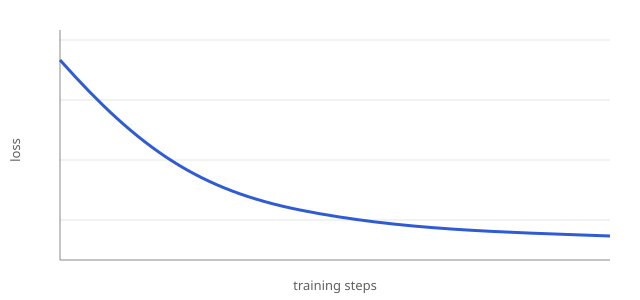

Copy this file to `_posts/YYYY-MM-DD-your-title.md` and replace the content. Text can be **bold**, *italic*, `inline code`, a [link](https://jekyllrb.com) or a footnote.[^1]

## Equations

Inline math uses double dollars: $$\mathcal{L}(\theta) = -\mathbb{E}_{(s,a)\sim\mathcal{D}}[\log \pi_\theta(a \mid s)]$$ is the behavioural-cloning loss.

A display equation goes on its own paragraph:

$$
V^\pi(s) = \mathbb{E}_\pi\!\left[\sum_{t=0}^{\infty} \gamma^t r_t \,\middle|\, s_0 = s\right]
$$

## Code

```python
import torch

def kl(p_logits: torch.Tensor, q_logits: torch.Tensor) -> torch.Tensor:
    """KL(p || q) between two categorical distributions given as logits."""
    p = p_logits.log_softmax(-1)
    q = q_logits.log_softmax(-1)
    return (p.exp() * (p - q)).sum(-1).mean()
```

```bash
bundle exec jekyll serve --drafts --livereload
```

## Tables

| Model (dummy data) | Params | Win rate (95% CI) |
|------------|-------:|-----------------------|
| Model A    |    10M | 50.0% [46.9, 53.1]    |
| Model B    |    10M | 55.0% [51.9, 58.1]    |

## Figures

<figure>
  
  <figcaption><strong>Figure 1.</strong> Captions go in a <code>figcaption</code>. Put images in <code>assets/img/posts/</code>.</figcaption>
</figure>

A plain Markdown image also works: ``.

## Quotes and lists

> The purpose of computing is insight, not numbers. (R. Hamming)

1. Numbered item
2. Another, with a nested list
   - nested bullet
   - another

- [x] Task lists render too
- [ ] Unchecked item

---

[^1]: Footnotes collect at the bottom of the post.
