---

## Table of contents {#table-of-contents}

- [Executive summary](#executive-summary)
- [Background: what is a Pokémon Showdown battle?](#background)
- [Why I started this](#why-i-started-this)
- [The plan: three approaches](#the-plan-three-approaches)
- [Approach I: Imitate](#approach-i-imitate)
- [Approach II: Learn from winning](#approach-ii-learn-from-winning)
- [Approach III: Think, then teach](#approach-iii-think-then-teach)
- [The smaller knobs I turned along the way](#the-smaller-knobs-i-turned-along-the-way)
- [What the experiments actually support](#what-the-experiments-actually-support)
- [The ending is also the beginning](#the-ending-is-also-the-beginning)
- [References](#references)

> **If you find this useful, please cite it.** I plan to open-source the LittleStar code soon and to write up the methods as a paper. Until then, if this post or its methods help your work, please cite this blog post (DOI: [10.5281/zenodo.24435628](https://doi.org/10.5281/zenodo.24435628); a BibTeX entry is at [the end](#the-ending-is-also-the-beginning)). Once the paper is out, please cite the paper.

---

## Executive summary {#executive-summary}

On October 20, 2026, my Pokémon bot **`vadmiral_slowbro`** finished its run on the Pokémon Showdown Gen 9 OU ladder with **79 wins and 28 losses (73.8%)**, a final **Elo of 1867**, and a peak of **1895**. A screenshot taken after its last game shows it at **rank #22**: a bot I built on a laptop, sitting in the **Top 25** of one of the most competitive Pokémon ladders in the world.

<figure>
  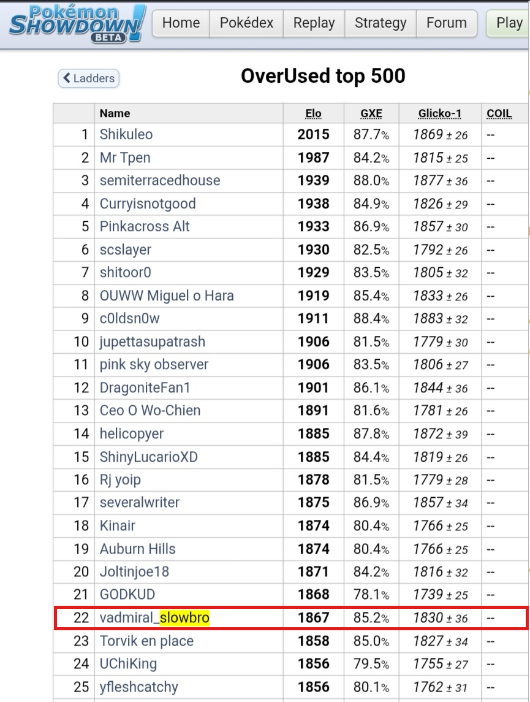
  <figcaption><strong>Figure 1.</strong> The October 20 leaderboard screenshot, with <code>vadmiral_slowbro</code> highlighted at #22 (Elo 1867, GXE 85.2%, Glicko 1830 ± 36). GXE is Showdown's rating-based estimate of how often you'd beat a random ladder player. All 107 rated games were played against the ordinary ladder population, before Showdown changed how bots get matched (more on that later). The screenshot was taken after the last game, so it shows #22 at that moment, not necessarily the bot's best-ever rank.</figcaption>
</figure>

The short version:

- **Background.** Pokémon Showdown is a free online battle simulator with a public ranked ladder. Gen 9 OverUsed (OU), one of its most popular competitive formats, is a six-versus-six game with simultaneous moves, randomness, and hidden information. That makes it a hard and fun test for AI.
- **Why.** I have loved Pokémon since I was a kid. I wanted a side project where I could learn reinforcement learning hands-on and try out a "team" of AI assistants as research collaborators. And I set myself one concrete goal: **get a bot I trained into the ladder's Top 500.** I had no idea how hard that would be. (Spoiler: very.)
- **How.** I led a small AI team: ChatGPT as research scientist, Claude as engineer, and Grok Bot as senior analyst. **The AI agents did the research legwork, implementation, training, and analysis. I orchestrated them**: I refined the research direction, contributed ideas, critiqued implementation approaches, and proposed and reviewed analyses. **I didn't write a single line of code myself.** The hardware was my MacBook Pro M4 Pro plus one small CPU server, with no GPU cluster. With this setup, **I went through all three approaches below in less than two months.** On my own, I estimate it would have taken at least six to nine months.
  1. **Imitate**: distill a large expert bot (Kakuna, 142.7M parameters) into a 12.76M-parameter student, and find the eight teams it plays best. Result: **#451**, my first Top-500 appearance.
  2. **Learn from winning**: fine-tune the student with reinforcement learning (PPO) against a curriculum of tough opponents. Result: **#247**.
  3. **Think, then teach**: add Gumbel search at decision time, then use MuZero-style Reanalyse to distill the searched decisions back into a new network, generation after generation. Results: **#21** (Search(H8), October 16) and **#22** (SD2-Search(SD2.3), October 20).
- **What I achieved.** Way past the Top-500 goal: **two documented Top-25 appearances (#21 and #22)**. Plenty of game-AI work runs on racks of datacenter GPUs like H100s; I got here with a MacBook Pro, and I'm really proud of that. Also, a +15.10-percentage-point gain in searched win rate on my local benchmark from recursive search distillation, and a well-documented record of what worked and what didn't.
- **What it is not.** I did not invent reinforcement learning, distillation, or search. I borrowed ideas from published work, adapted them to a partly hidden-information game, and tried to measure which ideas actually made a stronger player. Many did not.

---

## Background: what is a Pokémon Showdown battle? {#background}

[Pokémon Showdown](https://pokemonshowdown.com/) is a free, open-source battle simulator that runs in the browser [16]. There's no adventure part: you don't catch Pokémon or wander through towns like Pallet Town. You build a team of six Pokémon, with their moves, items, abilities, and stat spreads, and battle other players. Each format has a ranked ladder with Elo ratings and a public Top 500.

Here's what a battle looks like:

- **Six versus six, one active Pokémon each.** Each turn, both players choose at the same time: use one of four moves, switch to another Pokémon, and once per battle you can Terastallize (change type) as you attack.
- **Hidden information.** You see your opponent's six species at team preview. Their moves, items, abilities, and stat investments stay hidden until they are revealed in play. Good players spend a lot of time guessing what the other side is holding.
- **Randomness.** Damage rolls, critical hits, accuracy, and secondary effects all add noise. A single game says little; you need hundreds.
- **Team building matters.** The same player can look brilliant with one team and lost with another.

<figure>
  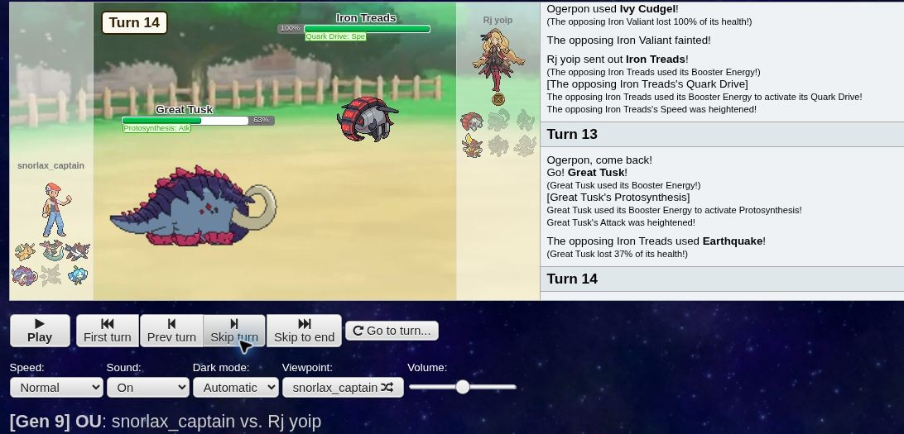
  <figcaption><strong>Figure 2.</strong> A real battle from my first ladder bot, <code>snorlax_captain</code> (<a href="https://replay.pokemonshowdown.com/gen9ou-2694993227">full replay</a>). On turn 13 it pulled a weakened Ogerpon out and switched in Great Tusk against the opponent's Iron Treads. Great Tusk took the Earthquake, and the bot went on to win. The right-hand panel is the battle log.</figcaption>
</figure>

For AI research, this combination is attractive. Like poker, it has hidden information. Like rock–paper–scissors, both sides commit at once. Like chess, it rewards long-term planning. And unlike most research games, there's a large, live human ladder you can actually test against. Tools like poke-env [17] let you connect a Python bot to it.

---

## Why I started this {#why-i-started-this}

I've been a Pokémon fan since I was a kid. More recently I'd been playing **Pokémon Champions** on the Nintendo Switch and got properly hooked on competitive battling: team building, predicting the switch, sweating over speed ties. Then, chatting with friends, I found out there was a free battle server where people play this all day: **Pokémon Showdown**. I started playing there too.

At some point a thought popped into my head: *why not build a bot that plays this, using machine learning and reinforcement learning?* And not just any bot. I wanted one that could **climb into the ladder's Top 500**, among the best human players. I had no idea how hard that would be, but I wanted to try.

The timing was right for two other reasons. I'd been looking for a side project where I could **actually learn reinforcement learning by doing it**, and I was curious how far I could push the new generation of **AI agents** as working teammates rather than chatbots. So I put together a small "AI research team" and acted as its technical lead:

*Table 1. The team: one human technical lead and three AI assistants, each with a role.*

| Who | Role | What they did |
|---|---|---|
| **Me (Johnny)** | Technical lead and project owner | Orchestrated the three AI agents, which did the research legwork, implementation, training, and analysis. I set the goals, refined the research direction, read up on RL, distillation, and search methods and brought in ideas, critiqued implementation approaches, proposed and reviewed analyses, and made every call on experiments, compute, and deployment. I wrote no code myself |
| **ChatGPT** | Staff research scientist | Helped frame hypotheses, designed experiments and evaluation gates, challenged interpretations, made stop/go recommendations |
| **Claude (Claude Code)** | Senior software / ML engineer | Built and ran the training, simulation, search, evaluation, and packaging pipelines on my Mac; wrote up results and opened pull requests |
| **Grok Bot** | Senior analyst | Ad-hoc analysis: ladder monitoring, win-rate calculations, replay and team analysis, status tracking |

The other constraint was compute, or rather the lack of it. I didn't want to rent a GPU cluster. I ran the main experiments on **my personal MacBook Pro (M4 Pro, 24 GB unified memory)**, plus the small CPU server Grok Bot runs on (8 vCPUs, about 15 GB RAM), and an ordinary $20/month subscription for each of ChatGPT, Claude, and Grok ($60/month in total).

(Fine print: training did use the Mac's built-in GPU through Apple's MPS backend, and the AI assistants run in their providers' clouds. "No cluster" refers to the simulation and training I ran myself.)

This setup turned out to be fast. **Everything in this post, all three approaches, took less than two months.** On my own, I'd guess it would have taken at least six to nine months. The AI teammates wrote all the code and could build and run an experiment overnight, while I read papers, critiqued their plans, and decided what to test next.

### It turns out Pokémon bots are a real research area

When I started reading, I found I was far from the first to try this, and the last couple of years have been especially active:

- **Metamon** (Grigsby et al., RLC 2025) trained Transformer agents with large-scale offline reinforcement learning on human Showdown replays and reached human-level competitive play [2]. The Metamon project's released agents include **Kakuna**, a ~142.7M-parameter policy that became my teacher [3].
- **PokéLLMon** (Hu et al., 2024) and **PokéChamp** (Karten et al., 2025) explored large language models as battle agents; PokéChamp combined an LLM with minimax search [4, 5].
- **Jaxcalibur** built an 8.5M-parameter Transformer trained with self-play RL on a JAX reimplementation of the battle engine, with search adapted for simultaneous moves and hidden information [6].

This was great news for me. With limited compute, I didn't have to start from zero. **What if I borrowed a strong existing bot and trained a much smaller network to imitate it?** That's knowledge distillation [1]. Combined with Metamon's teacher [2, 3] and DAgger-style training on the student's own states [7], it gave me my first research question.

### Picking my battlefield: Gen 9 OU

Showdown hosts dozens of formats, so the next decision was which one to play. I went with **Gen 9 OU**. "Gen 9" means the current generation of Pokémon games (Scarlet and Violet), with its full roster, moves, and the Terastal mechanic. "OU", short for **OverUsed**, is the main competitive singles tier, run under the rules of the [Smogon](https://www.smogon.com/) community: you bring six Pokémon, battle one-on-one with one active at a time, and can use almost anything except a list of banned, overpowered Pokémon and mechanics. It's where most of the competitive singles action happens, so the ladder is full of strong, active human players. It was also a format my future teacher, Kakuna, could already play. A popular format with a strong ready-made expert to learn from was exactly what a small-compute project needed.

---

## The plan: three approaches {#the-plan-three-approaches}

The project ended up as three approaches tried in sequence, each motivated by the limits of the previous one:

*Table 2. The three research questions, and where each approach landed on the public ladder.*

| Approach | Research question | Captured ladder result |
|---|---|---|
| **I · Imitate** | Can a small model learn strong Pokémon decisions from a larger expert, and can I find teams it plays well? | **N8 + Champion-8**: **#451**, October 8 |
| **II · Learn from winning** | Can that student go beyond copying its teacher by learning from battle outcomes and tougher opponents? | Greedy **H4**: **#247**, October 14 |
| **III · Think, then teach** | Can search improve decisions immediately, and then train the next neural policy? | **Search(H8)**: **#21**, October 16; **SD2-Search(SD2.3)**: **#22**, October 20 |

<figure>
  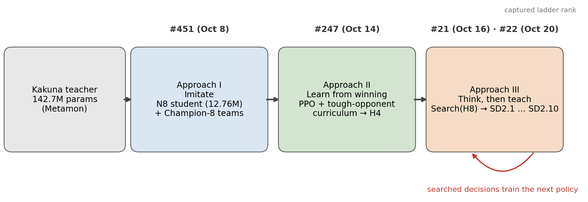
  <figcaption><strong>Figure 3.</strong> The project at a glance. Each approach builds on the previous model. In Approach III, searched decisions train the next policy, which then powers the next search.</figcaption>
</figure>

One caveat before I start. The ladder ranks are **observations**, not a controlled experiment: the account, date, model, and opponents all changed between screenshots. The strongest causal evidence comes from the controlled local comparisons I describe in each section.

Here's a map of every model I mention in this post. Don't worry about memorizing the names; come back to it whenever a new one shows up.

<figure>
  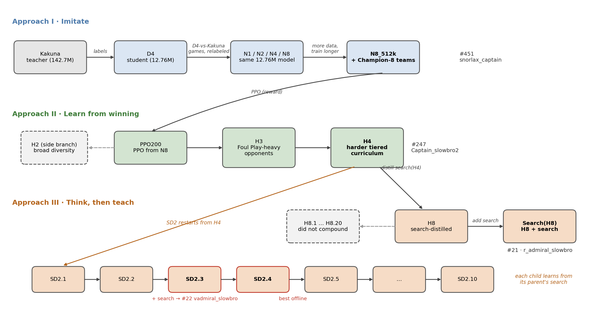
  <figcaption><strong>Figure 4.</strong> The model family tree. <strong>Approach I:</strong> Kakuna labels the student's decisions. D4 is an early student, and the games it played against Kakuna (relabeled by Kakuna) became the training data for N1–N8, which differ only in data amount and training length. <strong>Approach II:</strong> PPO200 is N8 fine-tuned with PPO; H3 and H4 add tougher opponent curricula (H2 was a side experiment). <strong>Approach III:</strong> H8 is trained on H4's searched decisions, and Search(H8) adds search on top of H8. The H8.1–H8.20 continuation didn't compound, so SD2 restarted from H4 and ran ten generations, each learning from its parent's search. Ladder ranks are shown next to the models that earned them.</figcaption>
</figure>

---

## Approach I: Imitate {#approach-i-imitate}

*Can a small model learn strong Pokémon decisions from a larger expert, and can I find teams it plays well?*

> **Takeaways**
> - Distilling the 142.7M-parameter Kakuna into a **12.76M-parameter** student worked, but only after I trained it on states *the student itself* reached (DAgger-style), not just the expert's games.
> - **More data helped only once I also trained longer.** N8_512k won **48.75%** against Kakuna itself, **+14.50 pp** over D4, my earlier student.
> - **Teams matter as much as the policy.** Picking the 8 teams my bot pilots best (Champion-8) gave **+9.63 pp** over an equal-size baseline set on fresh opponents.
> - Result: my **first-ever Top-500 appearance (#451)**, which none of my earlier imitation bots had managed. It slipped back out later.

### Starting much smaller than a champion

I started with plain *behavior cloning*: show the network a battle state and ask it to predict what an existing bot would do.

My first student had roughly **1.8 million parameters** and learned from a simpler bot called **Minikazam**. It beat random play quickly. Then, in its first 100-game match against its own teacher, it won only **26%**. Better training examples, more useful input features, and priors for the opponent's unrevealed sets all helped. By `bc_g4`, it was winning **52%** against Minikazam on my test pool.

That felt like progress. It was also a warning: beating one familiar teacher doesn't make you a competitive Gen 9 OU player, let alone a Top-500 one.

So I switched to a much stronger teacher: **Kakuna**, from the Metamon project [2, 3]. Kakuna has about **142.7 million parameters**. I wasn't trying to reproduce its training. I wanted to **transfer its decision-making into a model small enough to iterate on locally**.

### Roadblock #1: the student wanders into states the teacher never showed it

Imagine learning chess only by studying a grandmaster's games. In your own game you make an awkward move and land in a position the grandmaster would never reach. None of your study material covers it.

I hit exactly this. The student knew what Kakuna does *in Kakuna's positions*. Once the student was driving, it reached different positions and fell apart.

The fix: **let a student play, and ask Kakuna to label the decisions at the states the student actually reached.** I mixed those labels 50/50 with the original expert data and kept the student's own actions in the move history. This is the core idea of **DAgger** [7], and it's related in spirit to on-policy distillation from self-generated mistakes [8].

**The student architecture.** All my students from here on, D4 and N1–N8 included (see Figure 4), share one design with **12,760,405 parameters**, about **11× fewer** than Kakuna. (That's a parameter count, not an 11× speedup.) It has two levels of Transformer:

- One reads the current position as 12 Pokémon tokens plus a field token.
- A second, causal Transformer reads the **last 32 decisions**, so the model remembers revealed moves, switches, and what has happened so far.

On top of that are heads for the 14 possible actions (four moves, four moves-with-Tera, six switches), the lead Pokémon at team preview, and a predicted game outcome.

**How D4 and the N-series were trained.** D4 started from an earlier Kakuna-distilled checkpoint (`c2_mix50`). I trained it on about **1.5M Kakuna-labelled decisions** collected from student-played games, using **16k training steps**. The loss is mostly cross-entropy to Kakuna's chosen action, weighted by how costly a mistake at that state would be (the "regret"), plus a small outcome-value loss. Then D4 itself played lots of games against Kakuna, and Kakuna labeled every decision. That frozen pile of **D4-versus-Kakuna games** became the training data for N1, N2, N4, and N8. Each of these also starts from `c2_mix50` and uses **the same architecture and the same training recipe as D4**; the only differences are how much data they see and how long they train. So it's all still **supervised imitation**, not reinforcement learning from reward.

### Roadblock #2: bigger was not better

My first instinct was "make the model bigger." One 28.9M-parameter version fit its training data better and then *played worse* on fresh evaluation states. Value-calibration and action-ranking tweaks also improved nice-looking offline metrics without improving actual play.

So I asked a different question: **had I collected enough relevant states, and trained the current model long enough?**

### More data helped only once training kept up

N1, N2, N4, and N8 refer to the **amount of training data**, not model size.

*Table 3. The N-series data-scaling runs. All four use the same 12.76M-parameter architecture and the same training recipe as D4.*

| Model | Training rows |
|---|---:|
| N1 | 1.51M |
| N2 | 3.09M |
| N4 | 6.25M |
| N8 | 12.57M |

At the same 128k training steps, N8 at first **didn't** beat N4. Training longer changed the picture. On a fresh 800-game test against a 64-team opponent panel, **N8_512k won 48.75% against Kakuna itself**, **+14.50 percentage points [95% CI: +10.32, +18.68]** over D4. The extra gain from 384k to 512k steps was too small to resolve.

<figure>
  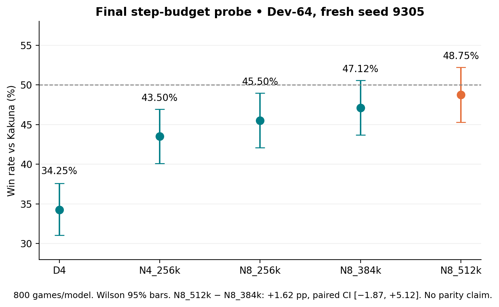
  <figcaption><strong>Figure 5.</strong> More data was not a free lunch. The training budget had to grow with the data before N8 pulled ahead.</figcaption>
</figure>

On fixed offline positions, N8 picked **exactly the same action as Kakuna 73.58%** of the time (averaged over three datasets). If you first tell it whether Kakuna attacked, switched, or Terastallized, agreement rises to **79.95%**. Neither number means "80% as strong as Kakuna"; they measure copying, not winning.

I now had a small student that captured much of the teacher's observable behavior. But Pokémon has a variable that most ML leaderboards don't have: **the team you're piloting.**

### Champion-8: finding the teams my bot actually plays well

This turned out to be one of the most important pieces of the whole project.

A policy can handle a bulky balance team well and then completely misplay a hyper-offense team. A team that wins in a top human's hands isn't necessarily strong in *my bot's* hands. An earlier experiment made this vivid: an 8-team subset beat a 64-team pool (63.96% vs 58.62%), which looked like "fewer teams is better". Then I found that about 95% of that edge came from just three teams. Removing them left only **+0.44 pp [−1.93, +2.79]**.

Team-pool *size* and team *membership* were tangled together. That changed how I thought about the problem. Maybe my bot is simply better at piloting certain teams. And maybe some team compositions are just naturally stronger and better balanced for this game. Instead of handing the bot a huge pool and letting it pick a team at random each battle, I should **find that small set of genuinely strong teams and focus on it.**

So I built a careful **select-then-confirm** procedure to identify **Champion-8**: the eight core teams my bot plays with. Before each battle it picks one of the eight at random. The hypothesis had two parts:

1. These teams are strong in general, out of the practically endless space of possible Gen 9 OU teams.
2. My bot pilots these teams especially well.

*Table 4. How Champion-8 was found. The key rule: never confirm a team on the same opponents used to pick it.*

| Step | What I did | Why |
|---|---|---|
| Start wide | Began from a training universe of **43,425 legal teams** (from Metamon's team sets), deployed a **256-team rotation** from it, and ranked those 256 (a ranking called **R07**) using team "fingerprints" (style, resources, win conditions) and repeated test games. That gave a 64-team pool (**R07_64**) and narrower 32/16/8-team subsets | Learn which teams the bot can pilot at all |
| Define candidates | Fixed a shortlist of **29 legal teams**: 3 "star" teams that had carried the width experiment (`lr1_151`, `lr1_141`, `lr1_089`), 13 rotation teams with strong earlier evidence, the 5 remaining members of the old R07_8 set, and 8 outside "challenger" teams chosen only for style diversity (bulky offense, hyper offense, balance, stall, weather) | Make the search space explicit; no swapping teams after seeing results |
| Define opponents | Built a **Selection panel of 1,024 complete opponent team sheets** from public Gen 9 OU replays, **reweighted** using a 2.1M-row rated-replay archive (Elo 1300–2183, December 2023 to May 2026) so the mix of ratings and dates resembles the real ladder, and every opponent team is piloted by Kakuna. The schedule is **paired**: every candidate faces the exact same 1,024 opponents with the same random seeds | Every team takes the same exam, so differences come from the team, not lucky draws |
| Select | Played **1,024 games per candidate** (29,696 games total) and ranked by a pre-set rule with diversity/tie handling | Measure how well *this policy* pilots each team |
| Freeze | Saved the top 8 and their hashes before looking at any confirmation games | Prevent tuning on the final test |
| Confirm | Tested Champion-8 against the R07 baselines on a **separate 1,024-opponent Confirmation panel** (8,192 games per arm) | Separate real team quality from lucky selection |

<figure>
  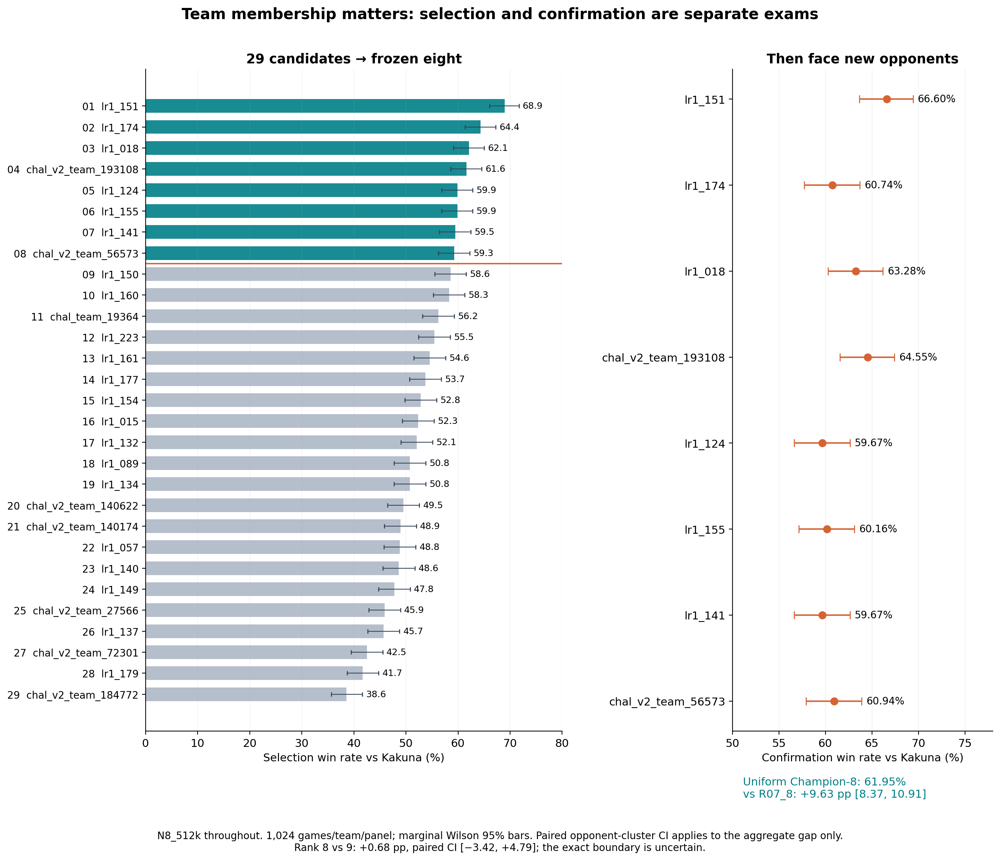
  <figcaption><strong>Figure 6.</strong> Left: all 29 candidate teams ranked on 1,024 Selection games each, with the 8 frozen members highlighted. Right: those 8 teams on the separate Confirmation panel. Ranks 8 and 9 were statistically very close (+0.68 pp [−3.42, +4.79]), so the exact cut-off is uncertain.</figcaption>
</figure>

The confirmation result was clear:

*Table 5. Confirmation results with the same N8_512k policy (8,192 games per arm).*

| Team pool | Description | Win rate on Confirmation |
|---|---|---:|
| **Champion-8** | The 8 teams picked by the Selection step above | **61.95% [60.75, 63.15]** |
| R07_8 | The top 8 teams of the earlier R07 ranking: the previous best guess at a strong 8-team set (equal-size baseline) | 52.32% |
| R07_64 | The top 64 teams of the R07 ranking: the earlier, wider pool | 48.12% |
| **Champion-8 − R07_8** | Gain from better team membership at the same pool size | **+9.63 pp [8.37, 10.91]** |

So after all that, the Champion-8 setup gave a big gain **without touching the network's weights at all**. Same brain, better-matched teams. Woohoo! The standout was **`lr1_151`**, a hyper-offense team that ranked **#1 of 29 in Selection (68.95%)** and was also the best of the eight in Confirmation (**66.60%**):

<figure>
  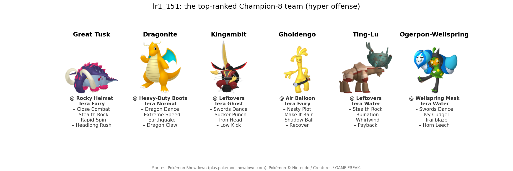
  <figcaption><strong>Figure 7.</strong> <code>lr1_151</code>, the top Champion-8 team: Great Tusk, Dragonite, Kingambit, Gholdengo, Ting-Lu, and Ogerpon-Wellspring. It pairs hazards and hazard control (two Stealth Rock setters, Rapid Spin) with setup sweepers (Dragon Dance Dragonite, Swords Dance Kingambit and Ogerpon, Nasty Plot Gholdengo).</figcaption>
</figure>

A caveat or two: this is evidence about team selection under this protocol, not proof that 8 is the magic number. And the 61.95% here and the 48.75% against Kakuna earlier come from different tests, so don't compare them.

Champion-8 also stuck around. **The same frozen eight teams were used by every ladder bot in this story**, including the #21 and #22 runs. After the period covered here, I kept revisiting the team question with larger audits and refreshed portfolios.

### First contact with the ladder

My first deployed bot was humble:

**N8_512k + Champion-8 teams + greedy action selection (no search).**

On October 8, `snorlax_captain` appeared at **#451** with Elo **1639** and GXE **70.7%**. Its first 145 games went **88–57**.

This was huge for me: **my first bot ever in the Top 500!** None of my earlier imitation bots, D4 included, had made it there. I was so happy and excited to see that name on the list.

<figure>
  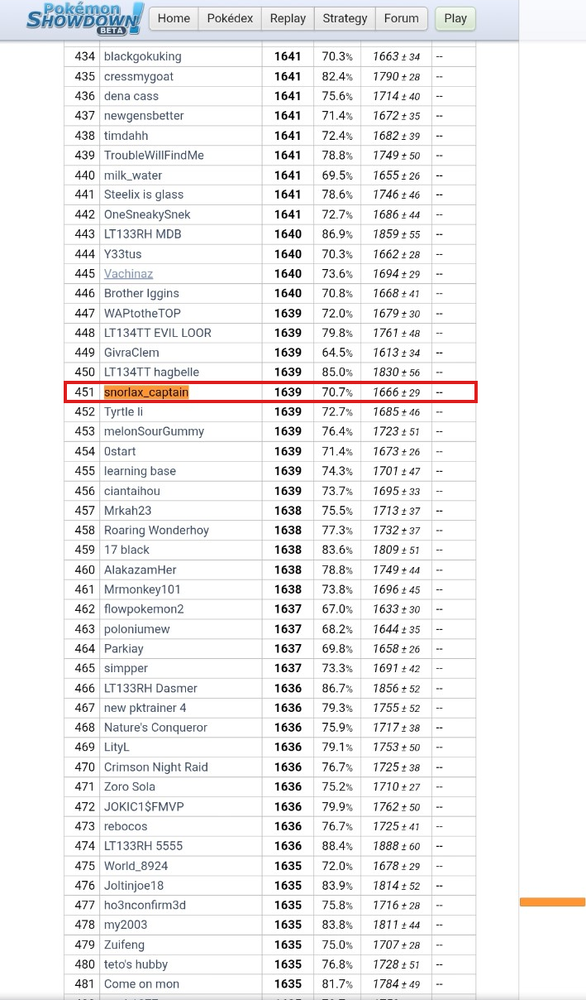
  <figcaption><strong>Figure 8.</strong> My first Top-500 appearance (October 8), with <code>snorlax_captain</code> highlighted at #451. It didn't last: a later snapshot showed the bot outside the Top 500 again. Staying there was its own challenge.</figcaption>
</figure>

I had a working student. The next challenge was to make it better than imitation alone could.

---

## Approach II: Learn from winning {#approach-ii-learn-from-winning}

*Can the student go beyond copying its teacher by learning from battle outcomes and tougher opponents?*

> **Takeaways**
> - I switched the training target from "what would Kakuna do?" to "what wins?" using **PPO** reinforcement learning, starting from the N8 student.
> - In my setup, PPO beat an MMD/V-trace alternative by **+5.20 and +3.56 pp** across two seeds, and almost all of the gain came from how it played the battle, not from picking better leads.
> - **Diverse opponents aren't the same as hard opponents.** The training opponents had to *punish* mistakes, so I built a curriculum heavy on Foul Play [18], a strong search-based bot, with opponent teams tiered by rating (H4).
> - Result: greedy **H4** reached **#247**, but its gains on my controlled tests were modest and uneven.

### From copying to winning

With imitation done, I had a student that copied Kakuna pretty well. But copying has a ceiling: the student can only be as good as its teacher's habits, mistakes included. The natural next step was **reinforcement learning (RL)**: let the bot play, reward it for winning, and let it figure out what works, even where that differs from Kakuna. This was also the part I was most excited to learn.

I used the most common workhorse in modern RL: **Proximal Policy Optimization (PPO)** [9]. The idea is simple. The bot plays a batch of games, and every decision gets credit or blame according to how the game turned out compared with what the bot expected. Generalized advantage estimation [10] is the standard way to compute that "better or worse than expected" signal. Then PPO nudges the policy toward the decisions that turned out better than expected, but **clips** each update so the policy can't change too much at once. That clipping is what makes PPO stable enough to fine-tune an already-good model. I also added a small KL penalty that keeps it close to the starting N8 policy, so it wouldn't throw away the competent behavior it already had.

*Table 6. Imitation versus reinforcement learning.*

| Imitation / distillation | Reinforcement learning |
|---|---|
| "Predict what the teacher would choose." | "Improve the policy using rewards from games." |
| Inherits useful behavior quickly | Can improve beyond agreeing with the teacher |
| Risks teacher mistakes and distribution shift | Risks noisy outcomes, unstable updates, and weak opponents |

### First, check that reward learning adds anything

I started PPO from N8 and trained against a league of frozen and historical LittleStar policies. At a matched **100,000-training-game budget**, my PPO setup beat a **magnetic-mirror-descent-style / V-trace** challenger [11, 12] by **+5.20 pp [3.52, 6.88]** and **+3.56 pp [1.86, 5.25]** across two seeds. That favors PPO *within these configurations*. It is not a universal ranking of RL algorithms. The PPO checkpoint after 200k training games became **PPO200**.

<figure>
  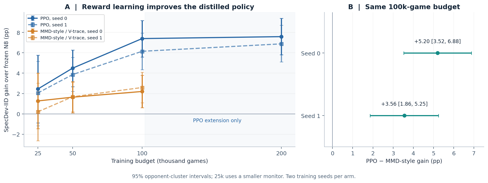
  <figcaption><strong>Figure 9.</strong> Two-seed learning curves for PPO and the MMD/V-trace comparison learner.</figcaption>
</figure>

**Did PPO actually learn to battle better, or did it just learn better openings?** Each game has two phases. At **team preview** the bot picks which Pokémon to lead with, and after that comes the **battle itself**. A better lead alone can win games, so I ran a mix-and-match test. I built two hybrid bots: one with PPO200's lead choice plus N8's battling, and one with N8's lead choice plus PPO200's battling. Then I compared them with the full PPO200 and with plain N8:

*Table 7. The mix-and-match ("splice") test, measured as gain over plain N8 on a panel built to resemble Top-500 ladder opponents.*

| Lead picked by | Battle played by | Gain over N8 |
|---|---|---:|
| N8 | N8 | 0 (baseline) |
| **PPO200** | N8 | +0.73 pp [−0.50, +1.92] |
| N8 | **PPO200** | **+7.85 pp [+5.81, +9.93]** |
| PPO200 | PPO200 | +8.65 pp [+6.28, +10.93] |

Swapping in PPO's battling alone recovered about **91%** of the full gain, while swapping in PPO's leads alone did almost nothing. So PPO really did learn to play the battle better.

### Roadblock #3: the opponents were too comfortable

PPO learns from whoever it plays against, so the next question was *who should the opponents be?* I tried a sequence of opponent setups, which I called **H2, H3, and H4**:

- **H2 (a side experiment): broad diversity.** PPO200 trained for 25k games against a bank of very different opponents: bots trained to imitate human players, independent Metamon policies, and older LittleStar models. And my learner was beating many of them **89–94%** of the time. Amazing, right? I was winning a lot! Except that's the problem: they added variety without pushing the learner to improve, and H2 showed no clear gain.
- **H3: prioritize the hard opponents.** H3 restarted from PPO200 and sampled opponent groups **according to how often the learner was losing to them**, aiming for a target difficulty. In practice that meant leaning heavily on **Foul Play** [18], a strong open-source bot that runs its own search, which ended up with about half of all training games.
- **H4: a deliberately designed curriculum.** H4 continued from H3 (with the input fix described below) and controlled precisely *which teams* the opponents use and *how much* each kind of opponent is played, as shown in Figure 10.

<figure>
  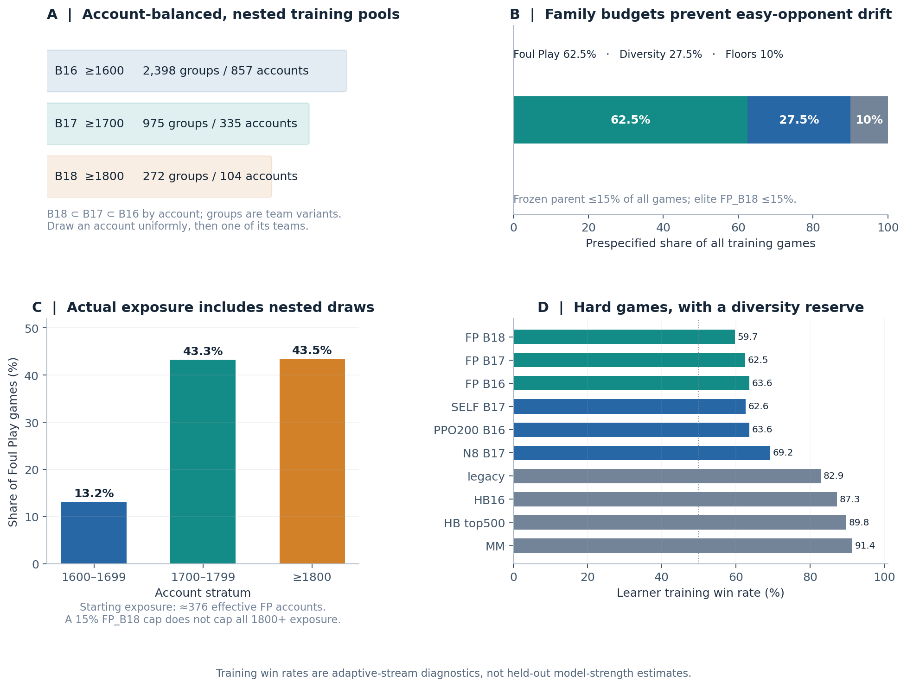
  <figcaption><strong>Figure 10.</strong> How the H4 curriculum was built. <strong>(A)</strong> Opponent teams come from public replays of real accounts, in three nested rating tiers: 1600+ (B16), 1700+ (B17), and 1800+ (B18). To stop a few prolific accounts from dominating, an account is drawn uniformly first and then one of its teams. <strong>(B)</strong> The planned share of training games: 62.5% against Foul Play, 27.5% against other policies for diversity, and 10% reserved as minimum "floors" for everyone else. The frozen parent is capped at 15%. <strong>(C)</strong> Because the tiers are nested (an 1800+ account is also a 1600+ account), at the starting mixture, Foul Play exposure was concentrated in the 1700–1799 and 1800+ strata (about 43% each). <strong>(D)</strong> The learner's win rate against each opponent group during training. Foul Play (FP) and the frozen LittleStar policies (SELF = the frozen parent, PPO200, N8) sit near 60–69%: hard but beatable. The diversity floors, made up of older "legacy" policies, human-imitation bots (HB16, HB top500), and Metamon policies (MM), are beaten 83–91% of the time. They're kept for coverage, not difficulty. Teams reconstructed from replays reflect what was publicly revealed, so they may not match every hidden original set.</figcaption>
</figure>

This shares a key motivation with **AlphaStar's league training** [13]. AlphaStar, DeepMind's StarCraft II agent, didn't just play against copies of itself. It trained inside a growing *league* of past versions plus special "exploiter" agents whose only job was to find its weaknesses. Opponents were sampled with **prioritized fictitious self-play**: the more often an opponent beat you, the more often you'd face it. The shared idea is to spend training time on opponents that expose your weaknesses, while keeping enough variety that you don't overfit to one style or forget how to beat old ones. H3's win-rate-based prioritization and H4's tiers and budgets are a much smaller, mostly frozen version of that idea, not a full self-play league. (And Foul Play itself used search; H4 did not.)

### Better in some tests, not everywhere

H4 started from H3 after a fix to the model's inputs (some revealed items and abilities had been going stale), and I compared it against H3 with the same fixed inputs. H4's main gain was **+3.81 pp [−0.49, +8.11]**: promising, but the interval crosses zero. Two other internal test panels were positive, but a panel built to resemble Top-500 ladder opponents was flat (**+0.18 pp [−1.50, +2.02]**). H4 was approved for a *ladder test*, not declared a winner.

On October 14, greedy H4 as `Captain_slowbro2` reached **#247**, Elo **1691**, GXE **72.0%**. That's a big jump up from #451, and in the Top 250 now!

<figure>
  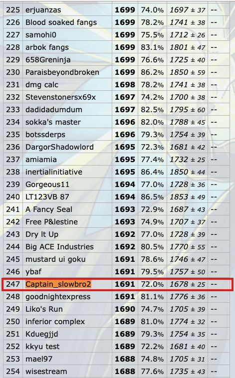
  <figcaption><strong>Figure 11.</strong> H4 at #247 (October 14), with <code>Captain_slowbro2</code> highlighted, still choosing actions greedily with the same Champion-8 teams. Its rating later fell: by game 674, later that evening, its Elo was down to about 1549. Holding a high rank on the real ladder was consistently harder than reaching it.</figcaption>
</figure>

---

## Approach III: Think, then teach {#approach-iii-think-then-teach}

*Can search improve decisions immediately, and then train the next neural policy?*

> **Takeaways**
> - **Search is an instant upgrade.** Simulating a few possible futures before each move beat greedy H8 by **+5.86 pp** in a check where search saw only what a real player sees. Search(H8), as `r_admiral_slowbro`, reached **#21**.
> - **Gumbel search + MuZero-style Reanalyse made this affordable on a laptop.** Gumbel search gets a good-enough move estimate from ~128–192 simulations instead of the ~800 per move AlphaZero used, and selective Reanalyse spends search only on the decisions that matter. By my rough estimate, together they cut one generation's search from days to about **5 hours**.
> - **Search can also teach, but the loop needs careful design.** H4 → H8 worked once; naively repeating it (H8.1–H8.20, 100k games) did not compound. The redesigned **SD2** loop lifted searched win rate against a frozen champion bot by **+15.10 pp** over the H4 starting point by SD2.3, then **plateaued** after SD2.4.
> - SD2-Search(SD2.3), as `vadmiral_slowbro`, went **79–28** and reached **#22**: the last run before Showdown changed bot matchmaking.
> - SD2.3 is the only SD2 model with a ladder run; **SD2.4 is my best offline model**, and the release includes both.

### Why search?

PPO's curves were flattening. H3's gain didn't grow in its second 25k games, H4's improvements were small and uneven, and some tactical mistakes just wouldn't go away no matter how many more games I trained. It felt like I'd squeezed most of what PPO could give me.

So I went looking for something beyond PPO, and kept coming back to the **AlphaGo** papers. AlphaGo [25] showed that **search on top of neural networks is a huge deal**: a network that "thinks ahead" with search plays far better than the raw network. AlphaGo Zero [26] and AlphaZero [20] went further: search can be used as a **teacher**: play lots of self-play games, let search pick better moves than the network would, then train the network to imitate the search. Repeat, and the policy gets stronger each round. Expert Iteration [14] describes the same idea as a fast "apprentice" network learning from a slow "expert" search. That was exactly the kind of loop I wanted, and it set my next research direction.

### Search: thinking before acting

Say the bot is choosing between an attack, a switch, and a setup move. A **greedy** policy just picks the network's favorite. A **searched** policy spends extra compute simulating what might happen after each candidate and picks the one that works out best.

The classic way to do this is **Monte Carlo Tree Search (MCTS)** [27, 28]. MCTS grows a tree of possible futures one simulation at a time. Each simulation walks down the tree, choosing branches that look promising or under-explored, adds a new node, evaluates it, and sends the result back up. With enough simulations it's very strong, which is why AlphaZero ran about 800 simulations per move. But "enough" is the catch. Every simulation in Pokémon means running the real battle simulator, and I also have to sample several guesses about the opponent's hidden sets. On a laptop, that adds up fast.

**Gumbel search** [15] was the key that made it work for me. Instead of growing a big tree, it focuses on the decision at hand:

1. **Pick candidates smartly.** It adds random "Gumbel" noise to the network's preferences and takes the top candidates, a way of sampling several *different* moves that favors the promising ones without always picking the same ones. With at most 14 legal actions in Pokémon, I simply kept them all, and the Gumbel noise was only switched on when generating training data; at play time it was off.
2. **Sequential halving.** It gives every candidate a few simulations, throws out the worse half, gives the survivors more simulations, and repeats until one move is left [29]. No compute is wasted on obviously bad moves.
3. **A better training target.** It turns the search results into an improved move distribution ("completed Q-values"). The paper shows this target improves on the network's policy even with only a handful of simulations (given reasonable value estimates), where classic AlphaZero-style MCTS can fail at such small budgets.

To me, Gumbel search doesn't give the *perfect* move. It gives a **good-enough estimate of the best move for a fraction of the compute**, and for Pokémon, where luck and hidden information blur everything anyway, that's plenty. For the #22 bot, search used **128 simulations plus up to 64 more on close calls (192 max)**, across **8 sampled guesses** of the opponent's hidden sets, looking **3 turns ahead**. (The #21 bot used 64 + up to 128, looking 2 turns ahead.) On the real ladder, the #22 bot's median decision took about **2.5 seconds**.

Then there's **MuZero** [21]. MuZero learns its own model of the game rules. I didn't do that, since I could just use the real Pokémon Showdown simulator. But MuZero's training loop shaped how I trained with search: play self-play games guided by search, store them, train the network on the search results, and repeat with the improved network. Most importantly, MuZero introduced **Reanalyse** [21, 19]: instead of playing every game with expensive search, you go back to games you've already played and **re-run search on stored positions** to produce fresh, better training targets. For me that was a lifesaver. I could play most games cheaply with the plain network and only spend search on a selected subset of positions afterward.

How much did this matter? Here's a back-of-envelope comparison for one training generation (10,000 games):

<figure>
  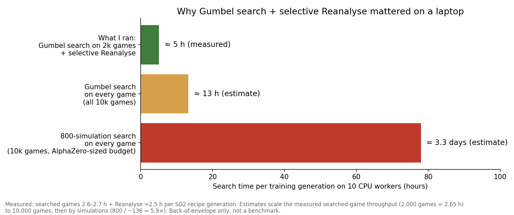
  <figcaption><strong>Figure 12.</strong> Search time per training generation on 10 CPU workers. Green is measured. Yellow and red are estimates scaled from the measured throughput of the searched games (2,000 games in about 2.65 h, so about 13 h for all 10,000), assuming cost proportional to the number of simulations: an 800-simulation search costs about 5.9× my ~136-simulation average. The saving mixes two effects: searching fewer positions (selective Reanalyse) and fewer simulations per position (Gumbel). The 800-simulation bar assumes AlphaZero's budget; Gumbel's real advantage is that it still improves the policy at small budgets, where plain MCTS may not. This is a rough estimate, not a benchmark. A real MCTS implementation could be faster or slower, and the hidden-information approximations make Pokémon search different from Go anyway.</figcaption>
</figure>

That's the difference between **one new model per day**, with evaluation included, and **one new model every few days**. With only a laptop, that was the difference between running ten generations and running one or two.

To be clear, this is still *inspired by* these methods, not a reproduction. I sample plausible hidden opponent sets (in the spirit of classic hidden-information planning [22, 23]), and I only search the current decision with short guided rollouts, not a deep tree. With hidden information and simultaneous moves, this approximation has real limits.

*Table 8. Three ways to use a trained network. **Greedy** means the bot plays the network's top choice instantly. **Search** means it first simulates possible futures for its candidate moves (with Gumbel search) and then picks. **Search distillation** means using those searched choices as training targets for the next network.*

| Mechanism | What changes? | Cost |
|---|---|---|
| **Greedy H4/H8** | Nothing at decision time; act from the network | Cheap |
| **Search(H4/H8)** | Same network, plus simulations before each move | More CPU time *per decision* |
| **Search distillation** | Use searched decisions to train a **new** network | Training cost now, possibly cheaper strong play later |

### A strong search doesn't automatically make a strong student

The first path that worked was **H4 → search-supervised H8 → Search(H8)**. H4 played 18,000 cheap self-play games plus about 2,000 games with Gumbel search. Then I **Reanalysed** about two-thirds of the cheap games: I re-ran search on a selected **25.6%** of their positions, chosen by a priority score plus some random coverage. That produced **153,025 search-policy labels** from **20,003 valid games**. H8's policy learned from those search targets; its critic (value network) learned from the actual game outcomes.

<figure>
  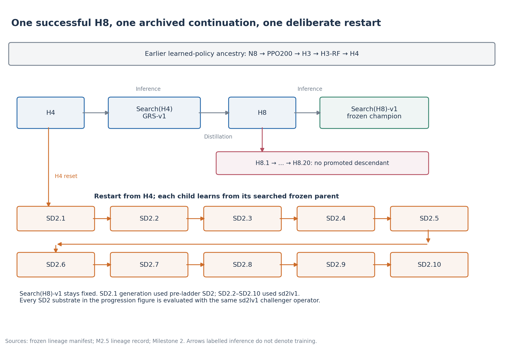
  <figcaption><strong>Figure 13.</strong> The full lineage of the search era, drawn from the verified checkpoint records. Solid "distillation" arrows produce a new trained network; "inference" arrows wrap an existing network in search without changing its weights. The chain starts at N8 and runs through PPO200, H3, and H4 (Approaches I–II). H4 is the parent of both <strong>H8</strong>, which with search becomes the #21 ladder bot <strong>Search(H8)</strong>, and the separate <strong>SD2 lineage</strong> (SD2.1 → … → SD2.10), which restarts from H4 rather than continuing H8. The frozen Search(H8)-v1 is also the champion that every SD2 generation is tested against.</figcaption>
</figure>

On the original paired evaluation, **greedy H8 won 69.76%** versus greedy H4's **66.29%**: **+3.47 pp [0.26, 7.54]** (1,240 games per arm). Then **search on top of H8** improved things *again*: **+5.86 pp [1.97, 10.26]** over greedy H8, in a later check where the search could see only what a real player sees.

That detail matters, and it's an honest-mistake story. I discovered that parts of the original search harness could see privileged simulator state, during both evaluation *and* generation of H8's training labels. The later leak-free check supports a real search advantage at play time. It doesn't retroactively clean up every H8 training label.

H8 didn't beat H4 everywhere, either. On a later frozen-champion comparison, its greedy edge over H4 flipped sign, though the difference was too small to call. I had to measure generalization; I couldn't assume it.

Meanwhile, the ladder gave me the most exciting moment of the project so far. On October 16, **Search(H8)**, running as **`r_admiral_slowbro`**, appeared at **#21**, Elo **1849**, GXE **89.1%**. From hoping for the Top 500 to the Top 25!

<figure>
  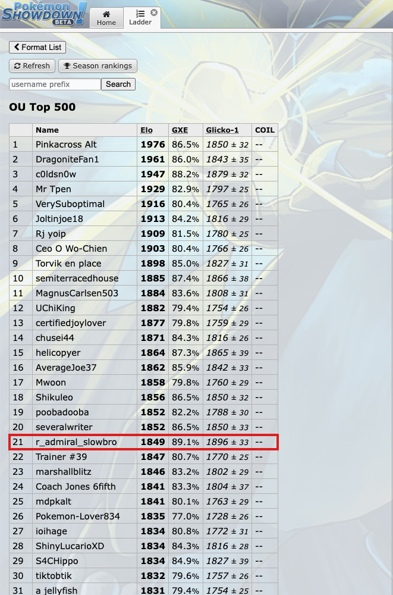
  <figcaption><strong>Figure 14.</strong> <code>r_admiral_slowbro</code> (Search(H8)) at #21 on October 16, highlighted. The run later peaked at about Elo 1884. This is a captured rank, not a head-to-head proof over H4.</figcaption>
</figure>

### Roadblock #4: "why not just repeat the distillation forever?"

I tried exactly that. It didn't work.

The **H8.1 → H8.20** continuation kept the same ingredients, Gumbel search and selective Reanalyse, but I hadn't planned the loop carefully:

- **Tiny steps.** Twenty small generations of 5,000 games each (4,750 cheap + 250 searched), each with only about 500 training steps. Every round brought little new signal.
- **Teacher and student blurred together.** Each new descendant immediately became the next teacher, so search noise could feed on itself.
- **Stale targets.** A quarter of each batch was replayed from old labels that were never refreshed, and the optimizer state carried over from round to round.
- **Selection thresholds that drifted.** The "which positions deserve search" thresholds were fixed numbers calibrated on H4. As the policy became flatter and more confident, they selected a very different volume of positions.

Over **100,000 new games**, the preregistered **greedy** comparison came out at **+1.6 pp [−3.0, +5.3]**, a separate 511-game **searched** comparison at **−3.7 pp [−9.4, +1.6]**, and a check on my older 11-team test set got worse. The models changed and some training losses improved, but the games didn't get better. My best read: noisy search labels combined with a learner step too weak to absorb them.

I also realized some of my test panels could no longer separate the models I cared about. So I froze the #21 bot, **Search(H8)-v1**, as a permanent sparring partner and built **Champion-Gate**: every challenger plays it 384 times: 64 Champion-8 team pairings × 2 sides × 3 sets of fresh random seeds. Think of it as my in-house exam. It isn't a measure of general strength, and because I kept retaking it, I could slowly overfit to it.

### SD2: a better-controlled recursive loop

So I redesigned the search configuration and the loop from scratch. **Search Distillation v2 (SD2)** restarted from **H4**. Each child inherited its parent's policy and critic, and the frozen parent's search provided the training labels for the next generation. The recipe combined:

1. **Bigger, cleaner generations:** **8,000 cheap + 2,000 searched games** per generation, a fresh optimizer, and no stale replay;
2. **Selective Reanalyse:** extra search spent on **20%** of the eligible positions from the cheap games, prioritizing close calls with high stakes (decisions involving switches, Tera, setup, hazards, recovery, and so on) while keeping some random coverage. "Interesting" was defined **relative to each parent**, so the selection didn't drift as the policy changed. This builds on MuZero's Reanalyse [19, 21], but the *selective* part, choosing which positions to re-search, is my own heuristic for a tight compute budget (related in spirit to prioritized replay; I'm not claiming it's new);
3. **Soft targets** that spread credit across moves according to how good the search thought each one was (Gumbel's "completed-Q" target [15], softened with `c_distill = 0.5`), instead of forcing a single hard "best move" label;
4. **A hardened, fixed search configuration** for the teacher and a **common search setup** for all challengers on Champion-Gate, so generations could be compared fairly.

Several changes arrived together, so I can't credit the improvement to any single one. SD2.1's search teacher also predates a later hardening of the hidden-information guard (SD2.2 onward used the hardened version). One full generation, meaning data, search, training, and evaluation, took about **10 hours** on my Mac, so I could run roughly one a day.

Here's how the whole lineage did against the frozen Search(H8)-v1 champion:

*Table 9. Champion-Gate win rates (%) against frozen Search(H8)-v1: 384 games per arm, 95% CIs. "Searched" applies the same SD2 search setup to every model, and "search lift" is searched minus greedy (paired). Bold marks the ladder-tested SD2.3 and the best offline point, SD2.4.*

| Model | Greedy win rate | Searched win rate | Search lift (pp) |
|---|---:|---:|---:|
| H4 (start) | 24.74 [19.53, 30.47] | 46.88 [40.89, 53.12] | +22.14 |
| SD2.1 | 20.57 [15.89, 25.52] | 51.56 [45.83, 57.29] | +30.99 |
| SD2.2 | 24.48 [19.79, 29.43] | 55.73 [50.00, 61.46] | +31.25 |
| **SD2.3** (ladder) | 29.95 [24.48, 35.68] | **61.98** [56.51, 67.19] | +32.03 |
| **SD2.4** (best offline) | 35.16 [28.91, 41.15] | **63.54** [58.33, 68.75] | +28.39 |
| SD2.5 | 35.68 [29.43, 42.19] | 57.55 [51.30, 63.80] | +21.88 |
| SD2.6 | 38.02 [32.03, 44.01] | 55.21 [48.44, 61.72] | +17.19 |
| SD2.7 | 40.36 [33.85, 46.88] | 62.76 [57.55, 67.71] | +22.40 |
| SD2.8 | 40.62 [34.64, 46.88] | 57.29 [51.30, 63.02] | +16.67 |
| SD2.9 | 40.10 [33.85, 46.35] | 57.55 [51.56, 63.28] | +17.45 |
| SD2.10 | 41.41 [34.38, 48.18] | 58.59 [51.82, 65.36] | +17.19 |

<figure>
  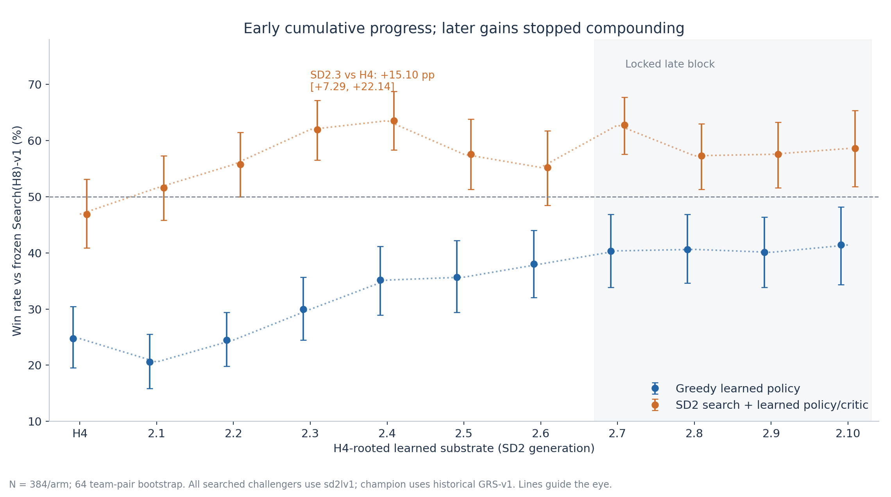
  <figcaption><strong>Figure 15.</strong> Searched (orange) and greedy (blue) win rates against the same frozen champion. The searched curve climbs through SD2.3–SD2.4 and then plateaus between about 55% and 63%, while the greedy network keeps slowly improving.</figcaption>
</figure>

What I take from this:

- **Search-guided learning worked, at least on my in-house exam.** With MuZero-style Reanalyse and Gumbel search in the loop, and a much more carefully designed loop than H8.x, Champion-Gate improved well beyond the PPO starting point (other test panels were more mixed). Searched SD2.3 beat the H4 starting point by **+15.10 pp [7.29, 22.14]**, and SD2.4 by **+16.67 pp [9.11, 23.96]**.
- **Individual steps were small.** Most single-generation changes were too small to resolve on their own (SD2.3 − SD2.2 was +6.25 pp [−1.30, +14.06]). The gain is cumulative.
- **Then it plateaued.** After SD2.4, the searched win rate bounced between ~55% and ~63%. SD2.7 had one confirmed recovery (+7.55 pp over SD2.6), but SD2.7–SD2.10 showed no resolved gain as a block.
- **Greedy kept improving while searched didn't.** The network itself got steadily better (24.7% → 41.4% greedy), while the *search lift* shrank from about +32 to about +17 pp. My reading: the student was absorbing what the search knew, while the fixed search configuration stopped adding much.

**Why the plateau?** I don't have a single proven cause, but I have some plausible suspects:

- **Noisy search values.** A fixed-budget search gives noisy estimates, so later labels may carry more noise than new signal.
- **A mismatched critic.** The value network may be biased, or out of step with the newer policy.
- **Wrong guesses about the opponent.** Errors in the sampled hidden sets and the opponent model can't be fixed by distillation.
- **Too little new to learn.** Later generations may get few genuinely new corrections.
- **Capacity and distribution shift** may also play a part.

One way to read the record: the student learned to imitate the search well, but the teacher (a fixed search configuration) stopped getting stronger. The plateau is specific to this recipe; it doesn't prove recursive self-improvement can't work.

### The final pre-opt-in ladder chapter: Top 25!

On October 20, I put **SD2-Search(SD2.3)** on the ladder as **`vadmiral_slowbro`**, and it just kept winning.

Its 107 games ended **79–28 (73.8%)**. Elo climbed all the way to a peak of **1895** (game 87) and finished at **1867**. Then I pulled up the leaderboard and there it was: **#22 in the Gen 9 OU Top 500.** That's the image from the start of this post:

<figure>
  
  <figcaption><strong>Figure 16.</strong> <code>vadmiral_slowbro</code> (SD2-Search(SD2.3)) at #22 on October 20, highlighted: Elo 1867, GXE 85.2%. GXE is derived from the rating; it isn't the same as the 73.8% actual win rate.</figcaption>
</figure>

I honestly couldn't believe it at first. Twelve days earlier, my first bot had only just scraped into the Top 500, which had been my whole goal. Now a 12.76M-parameter student, trained on a MacBook Pro and one small CPU server, guided by a few seconds of search per move, was sitting among the top two dozen players of one of the most competitive Pokémon ladders anywhere. And it was playing against the general ladder population, real human players. It's the achievement I'm proudest of in this whole project. Plenty of game-AI work runs on clusters of datacenter GPUs; this ran on a laptop.

<figure>
  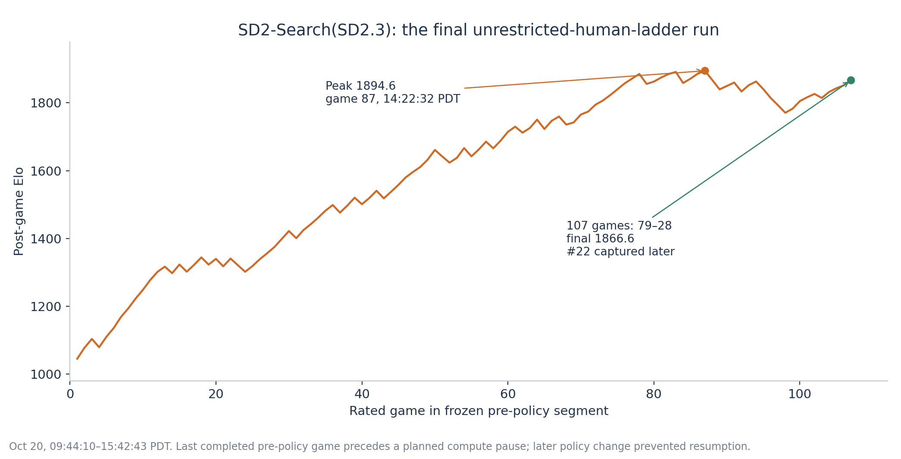
  <figcaption><strong>Figure 17.</strong> Elo across all 107 games: the climb, the peak at game 87, and the pullback are all part of the record. I only have rank screenshots at specific moments, so the peak Elo doesn't tell me the peak rank.</figcaption>
</figure>

*A note on forfeits:* 36 of the 79 wins came from the opponent forfeiting and two from inactivity. Those are valid rated wins, and I can't know why each opponent quit. Using only played-out games would be selection-biased, so I don't use that as a replacement headline.

I wanted more games, with a target of 128 and then 256. Then the platform changed. **On October 20, Pokémon Showdown introduced bot opt-in matchmaking** [16]. Since then, registered bot accounts are matched only with other bots or with human players who have explicitly opted in using the `/allowbots` command. Before that, bots were matched with the general ladder population. Overnight, the open human ladder I'd been testing on was gone for bots. SD2.3's run ended because the rules changed, not because I stopped at a good-looking point. Nothing played after the change is counted in this story.

### Two Top-25 captures, and one important footnote

**Search(H8)'s #21 and SD2.3's #22 are my two documented Top-25 appearances.**

The footnote: **SD2.3 is the only SD2 model with a pre-opt-in ladder result**, because it was the model ready to deploy on October 20. But **SD2.4 is my best model on the offline benchmark**: 63.54% searched on Champion-Gate, and **+5.21 pp [0.78, 9.90]** greedy over SD2.3. SD2.4's evaluation cycle overlapped the October 20 change, so it never got a comparable ladder run. That's why **the model release includes both SD2-Search(SD2.3)**, the ladder-tested one, **and SD2-Search(SD2.4)**, the strongest one I measured offline.

---

## The smaller knobs I turned along the way {#the-smaller-knobs-i-turned-along-the-way}

Alongside the three approaches, I also looked into:

- **Distillation sharpness (`c_distill`).** This controls how strongly the search's Q-values are turned into a training target. In an exploratory comparison, `c_distill = 0.5` looked slightly better and became the SD2 working choice. It was not a proven optimum.
- **Which states to re-search.** An absolute "interesting state" threshold changed label volume as the policy became more confident, so SD2 switched to thresholds calibrated relative to each parent.
- **Model size, value calibration, and action ranking.** As mentioned in Approach I, these often improved offline metrics without improving play.
- **Search settings.** Number of sampled opponent sets, simulations per move, extra simulations on close calls, and a guard against illegal or trapped actions.
- **Evaluation design itself.** Fixed opponent panels, fresh seeds, paired comparisons, confidence intervals, and preregistered gates, so I could tell a real 3-point gain from noise [24].

---

## What the experiments actually support {#what-the-experiments-actually-support}

Let's look at the whole model journey on the ladder. I still get a kick out of this chart: from a first scrape into the Top 500, to #247, to **two separate Top-25 finishes**, all from a laptop.

<figure>
  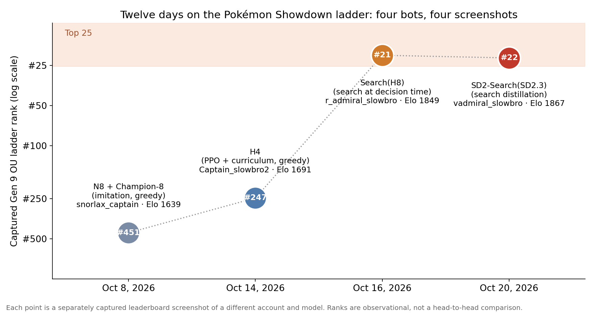
  <figcaption><strong>Figure 18.</strong> Twelve days on the ladder: four bots, four screenshots, from #451 to #21 and #22. My original goal was just to get into the Top 500; the bots ended up more than 400 places higher. Each point is a different account and model, so this is a story arc, not a controlled comparison.</figcaption>
</figure>

*Table 10. Claims and how well the evidence supports them.*

| Claim | Evidence status |
|---|---|
| A compact student learned much of Kakuna's decision behavior | **Supported** by offline agreement and controlled games |
| Better team selection helped at equal pool size | **Supported** by Champion-8 Selection/Confirmation |
| My PPO recipes improved the imitation-trained policy | **Supported on development panels**; transfer varied |
| Search improved H8's decisions without privileged information | **Supported** by the leak-free check |
| Recursive SD2 gave a cumulative improvement by SD2.3 and SD2.4 | **Supported on Champion-Gate**, not at every step, and it plateaued afterwards |
| Search(H8) reached #21 and SD2.3 reached #22 on the pre-opt-in ladder | **Directly documented** by screenshots and game logs |
| Each newer ladder bot was causally stronger than the last | **Not established**: accounts, dates, and opponents changed |
| A Mac plus three AI assistants causes better research productivity | **Not established**: a case study, not a controlled experiment |

Three lessons have stuck with me:

**1. Optimize decisions, not proxies.** A model can imitate well without winning. A critic can be better calibrated without picking better moves. A loss can go down without play getting better. Every time I trusted a proxy on its own, it eventually let me down.

**2. Opponents, teams, and evaluation are part of the algorithm.** Picking the right teams gave one of my biggest gains without changing a single weight. Training needs opponents that punish mistakes, and evaluation needs opponents you didn't train on.

**3. Search is both a player and a teacher, and those are two different jobs.** Thinking harder at play time helped immediately. Distilling that thinking back into the network helped for a while, then stalled. Measuring the two separately is what made the SD2 results interpretable.

And the "AI research team"? I can't prove three assistants beat one, or beat humans. What I can say is that the workflow ran a real empirical research program on a laptop and one small server in a short time. Designs, preregistrations, model hashes, confidence intervals, failed experiments, and corrections all lived in the repository and its pull requests, not just in chat logs.

For scale, one N8_512k training run took about **10.6 hours** on the Mac's GPU, and one data-collection stage generated **85,786 games in 26.4 hours**. You don't need a GPU cluster to study strong decision-making. You *do* need a simulator, good baselines, existing teacher models, compute-efficient methods like Gumbel search and Reanalyse, and the patience to let negative results change your plans.

---

## The ending is also the beginning {#the-ending-is-also-the-beginning}

I started with a small model trying to copy an expert. I taught it to recover from its own mistakes, gave it teams it could actually pilot, trained it against opponents that punished it, let it think before moving, and finally let its own search teach the next generation.

Some ideas failed. Others worked only on the distribution that exposed them. A few survived controlled tests and made it into real games.

My goal was a bot in the Top 500, which turned out to be much harder than I expected. On October 20, my compact student and its search closed out an era of Pokémon Showdown matchmaking with **79 wins in 107 games** and a **documented Top-25 appearance**.

For me, the most rewarding part isn't the screenshot. It's that a small, carefully audited system, built on a laptop by one person and three AI collaborators in a short time, got that far, and that I learned a lot about reinforcement learning, imitation learning, and search along the way.

I'm an AI researcher passionate about healthcare, machine learning, and technology that helps people. This project was how I kept learning in my spare time, and this post is how I share it. If you're thinking about a side project like this: pick a game you love, borrow from the giants, measure honestly, and just start.

The research continued after October 20, with stronger search, opponent modeling, and the new opt-in ladder. That's a story for the next post.

**What's next, and how to cite.** I plan to **open-source the LittleStar repository** soon and to **write the methods up as a paper**. For now, if you found this post interesting or its methods useful, please cite it:

```bibtex
@misc{ho2026littlestar,
  author       = {Ho, Johnny},
  title        = {How I Trained a Competitive Pok{\'e}mon {AI} Agent Using a {MacBook} in Less Than 2 Months! From Imitation Learning and Reinforcement Learning to Search, Reaching the Top 25 in Gen 9 {OU} on the Pok{\'e}mon Showdown Simulator},
  year         = {2026},
  month        = nov,
  doi          = {10.5281/zenodo.24435628},
  howpublished = {Blog post, \url{https://johnny5550822.github.io/blog/pokemon-ai-on-a-macbook/}},
  note         = {Team LittleStar}
}
```

Once the paper is out, please cite the paper instead.

---

## References {#references}

1. Hinton, G., Vinyals, O., and Dean, J. (2015). [*Distilling the Knowledge in a Neural Network*](https://arxiv.org/abs/1503.02531). arXiv:1503.02531.
2. Grigsby, J., Xie, Y., Sasek, J., Zheng, S., and Zhu, Y. (2025). [*Human-Level Competitive Pokémon via Scalable Offline Reinforcement Learning with Transformers*](https://arxiv.org/abs/2504.04395). Reinforcement Learning Conference (RLC).
3. Metamon authors and contributors. [*Metamon: Pokémon Showdown RL agents and datasets*](https://github.com/UT-Austin-RPL/metamon) (source of the Kakuna teacher); [model checkpoints](https://huggingface.co/jakegrigsby/metamon).
4. Hu, S., Huang, T., and Liu, L. (2024). [*PokeLLMon: A Human-Parity Agent for Pokémon Battles with Large Language Models*](https://arxiv.org/abs/2402.01118). arXiv:2402.01118.
5. Karten, S., Nguyen, A. L., and Jin, C. (2025). [*PokéChamp: an Expert-level Minimax Language Agent*](https://arxiv.org/abs/2503.04094). ICML 2025.
6. Jaxcalibur project. [*How Jaxcalibur works*](https://jaxcalibur.github.io/). Technical project page.
7. Ross, S., Gordon, G. J., and Bagnell, J. A. (2011). [*A Reduction of Imitation Learning and Structured Prediction to No-Regret Online Learning*](https://proceedings.mlr.press/v15/ross11a.html). AISTATS.
8. Agarwal, R., Vieillard, N., Zhou, Y., Stanczyk, P., Ramos, S., Geist, M., and Bachem, O. (2024). [*On-Policy Distillation of Language Models: Learning from Self-Generated Mistakes*](https://arxiv.org/abs/2306.13649). ICLR.
9. Schulman, J., Wolski, F., Dhariwal, P., Radford, A., and Klimov, O. (2017). [*Proximal Policy Optimization Algorithms*](https://arxiv.org/abs/1707.06347). arXiv:1707.06347.
10. Schulman, J., Moritz, P., Levine, S., Jordan, M. I., and Abbeel, P. (2016). [*High-Dimensional Continuous Control Using Generalized Advantage Estimation*](https://arxiv.org/abs/1506.02438). ICLR.
11. Sokota, S., D'Orazio, R., Kolter, J. Z., Loizou, N., Lanctot, M., Mitliagkas, I., Brown, N., and Kroer, C. (2023). [*A Unified Approach to Reinforcement Learning, Quantal Response Equilibria, and Two-Player Zero-Sum Games*](https://arxiv.org/abs/2206.05825). ICLR.
12. Espeholt, L., et al. (2018). [*IMPALA: Scalable Distributed Deep-RL with Importance Weighted Actor-Learner Architectures*](https://arxiv.org/abs/1802.01561). ICML.
13. Vinyals, O., et al. (2019). [*Grandmaster level in StarCraft II using multi-agent reinforcement learning*](https://doi.org/10.1038/s41586-019-1724-z). Nature 575, 350–354.
14. Anthony, T., Tian, Z., and Barber, D. (2017). [*Thinking Fast and Slow with Deep Learning and Tree Search*](https://proceedings.neurips.cc/paper/2017/hash/d8e1344e27a5b08cdfd5d027d9b8d6de-Abstract.html). NeurIPS.
15. Danihelka, I., Guez, A., Schrittwieser, J., and Silver, D. (2022). [*Policy improvement by planning with Gumbel*](https://openreview.net/forum?id=bERaNdoegnO). ICLR.
16. Pokémon Showdown. [Website](https://pokemonshowdown.com/) and [simulator source code](https://github.com/smogon/pokemon-showdown). The October 20, 2026 bot opt-in change corresponds to upstream commits [de1cf59](https://github.com/smogon/pokemon-showdown/commit/de1cf59) and [7777a79](https://github.com/smogon/pokemon-showdown/commit/7777a79).
17. Sahovic, H., and contributors. [*poke-env: a Python interface for Pokémon Showdown bots*](https://github.com/hsahovic/poke-env).
18. Foul Play authors and contributors. [*Foul Play: a Pokémon Showdown battle bot*](https://github.com/pmariglia/foul-play).
19. Schrittwieser, J., Hubert, T., Mandhane, A., Barekatain, M., Antonoglou, I., and Silver, D. (2021). [*Online and Offline Reinforcement Learning by Planning with a Learned Model*](https://arxiv.org/abs/2104.06294). NeurIPS.
20. Silver, D., et al. (2018). [*A general reinforcement learning algorithm that masters chess, shogi, and Go through self-play*](https://doi.org/10.1126/science.aar6404). Science 362, 1140–1144.
21. Schrittwieser, J., et al. (2020). [*Mastering Atari, Go, chess and shogi by planning with a learned model*](https://doi.org/10.1038/s41586-020-03051-4). Nature 588, 604–609.
22. Silver, D., and Veness, J. (2010). [*Monte-Carlo Planning in Large POMDPs*](https://proceedings.neurips.cc/paper/2010/hash/edfbe1afcf9246bb0d40eb4d8027d90f-Abstract.html). NeurIPS.
23. Cowling, P. I., Powley, E. J., and Whitehouse, D. (2012). [*Information Set Monte Carlo Tree Search*](https://doi.org/10.1109/TCIAIG.2012.2200894). IEEE Transactions on Computational Intelligence and AI in Games 4(2), 120–143.
24. Agarwal, R., Schwarzer, M., Castro, P. S., Courville, A., and Bellemare, M. G. (2021). [*Deep Reinforcement Learning at the Edge of the Statistical Precipice*](https://arxiv.org/abs/2108.13264). NeurIPS.
25. Silver, D., et al. (2016). [*Mastering the game of Go with deep neural networks and tree search*](https://doi.org/10.1038/nature16961). Nature 529, 484–489.
26. Silver, D., et al. (2017). [*Mastering the game of Go without human knowledge*](https://doi.org/10.1038/nature24270). Nature 550, 354–359.
27. Kocsis, L., and Szepesvári, C. (2006). [*Bandit Based Monte-Carlo Planning*](https://doi.org/10.1007/11871842_29). ECML 2006, Lecture Notes in Computer Science 4212.
28. Browne, C. B., et al. (2012). [*A Survey of Monte Carlo Tree Search Methods*](https://doi.org/10.1109/TCIAIG.2012.2186810). IEEE Transactions on Computational Intelligence and AI in Games 4(1), 1–43.
29. Karnin, Z., Koren, T., and Somekh, O. (2013). [*Almost Optimal Exploration in Multi-Armed Bandits*](https://proceedings.mlr.press/v28/karnin13.html). ICML.

**Software and credit.** Metamon, Pokémon Showdown, poke-env, and Foul Play are independent open-source projects. Pokémon sprites in Figure 7 are from Pokémon Showdown. Pokémon and all related names are trademarks of Nintendo, Creatures, and GAME FREAK. No affiliation or endorsement is implied.
